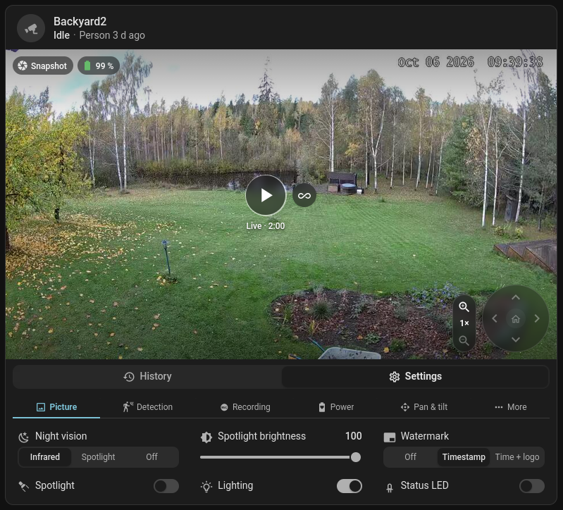

  

# Anker eufy Home Security for Home Assistant

Control of eufy Security HomeBases and the devices paired to them, and of standalone
eufy cameras: alarm panel, detections, camera stills, live video, pan/tilt presets,
lights and device settings.

Where a device allows it, Home Assistant talks to it directly on your network. The
eufy cloud is still used for sign-in, the device list and device keys; for detections
from standalone cameras and a HomeBase 2 (cloud push, when switched on); and for a
station that Home Assistant cannot find on its own network and to wake a battery
camera, both through eufy's servers. The protocol work is done by the
[`eufy-home-security`](https://pypi.org/project/eufy-home-security/) library
([source](https://github.com/alaraun/python-eufy-home-security)), which Home Assistant
installs automatically. Library bugs that show without Home Assistant go to [its issue
tracker](https://github.com/alaraun/python-eufy-home-security/issues).

> [!WARNING]
> Beta. Only the devices in
> [Supported devices](https://github.com/alaraun/homeassistant-eufy-home-security/blob/main/docs/devices.md)
> are tested, and a minor release may change entities or options. Keep the eufy app
> installed. Not affiliated with or endorsed by Anker or eufy.

  
   The camera card that comes with the integration: one or several cameras, live view, pan/tilt, presets, history and settings.

## Supported devices

| Device | In Home Assistant |
|---|---|
| HomeBase | alarm panel for the security mode, siren where supported, storage, event history |
| Cameras: battery and wired, on a HomeBase or standalone, indoor pan & tilt, floodlight and wall light cameras | camera with stills, live video where the model supports it, detections, pan/tilt and presets, the lamp as a light, settings |
| Video doorbells | as a camera, plus a ring event |
| Motion and entry sensors | motion or door binary sensor, battery or tamper where reported |
| Smoke sensors | smoke, problem, end of life, low battery, alarm muted and testing binary sensors |
| Smart locks, video smart locks included, where the library reads their state (Wi-Fi locks without a HomeBase not yet) | lock showing locked, unlocked or jammed, with lock and unlock where the library sends the lock's command over its station (declared from the eufy app, not tested on hardware) |
| Garage door cameras (T8452, T8453) | a garage door per door, open and close where a motor is connected |
| Keypads and other eufy devices | added as devices, with the settings the library knows |

Only some models are tested on hardware; the others follow the eufy app's own model
data. Model by model:
[Supported devices](https://github.com/alaraun/homeassistant-eufy-home-security/blob/main/docs/devices.md).

## Requirements

- Home Assistant **2026.11.0** or newer, with ffmpeg (included in Home Assistant OS
  and the official container) for 4K stills.
- Home Assistant on the same LAN as the HomeBase is the fastest path (host networking
  in Docker). A station on another subnet or at another site connects through eufy's
  servers (not behind a symmetric NAT). Firewall, reverse proxy and browsers:
  [Network and security](https://github.com/alaraun/homeassistant-eufy-home-security/blob/main/docs/network.md).
- Live view reads each camera from Home Assistant's own port on `127.0.0.1`: TLS on
  that port works, an `http: server_host` bound only to a LAN address does not
  ([stream access](https://github.com/alaraun/homeassistant-eufy-home-security/blob/main/docs/network.md#stream-access)).
- A eufy account that sees the HomeBase: the owner's, or one it is shared with. Use a
  separate account for Home Assistant: a sign-in elsewhere with the same account ends
  Home Assistant's session, so accept the owner's invitation from Home Assistant's
  repair, not on a phone.

## Installation

1. **Settings → Marketplace** → search for **Anker eufy Home Security** (or use the
   button above).
2. **Install** it, and restart Home Assistant if the Marketplace asks for it.

An install added as a custom repository needs no change: the Marketplace lists it from
its catalog and keeps updating it.

Manual: download the source archive of the latest
[release](https://github.com/alaraun/homeassistant-eufy-home-security/releases), copy its
`custom_components/eufy_home_security` into your configuration's `custom_components`
directory and restart.

## Setup

1. **Settings → Devices & services → Add integration → Anker eufy Home Security**.
2. Enter the eufy account's e-mail and password. This is one eufy sign-in; the
   session is kept, so restarts do not sign in again.
3. Every HomeBase, its paired devices and every standalone camera appear as devices.

eufy allows only a few sign-ins per account per day
([details](https://github.com/alaraun/homeassistant-eufy-home-security/blob/main/docs/network.md#eufy-account));
Home Assistant never signs in by itself.

Devices added to the eufy account later: press **Refresh device list** on the
**eufy account** device.

The camera card comes with the integration: edit a dashboard → **Add card** →
**eufy camera**
([Camera card](https://github.com/alaraun/homeassistant-eufy-home-security/blob/main/docs/card.md)).
So does a card per HomeBase: **eufy HomeBase**
([HomeBase card](https://github.com/alaraun/homeassistant-eufy-home-security/blob/main/docs/homebase-card.md)).

## Documentation

| | |
|---|---|
| [Usage](https://github.com/alaraun/homeassistant-eufy-home-security/blob/main/docs/usage.md) | options, alarm panel, camera images, event history and videos, live video, pan/tilt, settings and lights, signing in again, removal |
| [Camera card](https://github.com/alaraun/homeassistant-eufy-home-security/blob/main/docs/card.md) | the dashboard card that comes with the integration: install, options, layout, writes |
| [HomeBase card](https://github.com/alaraun/homeassistant-eufy-home-security/blob/main/docs/homebase-card.md) | the HomeBase's dashboard card: security mode, what each device does per mode, arming groups, settings, status |
| [Supported devices](https://github.com/alaraun/homeassistant-eufy-home-security/blob/main/docs/devices.md) | tested models, settings, adding a device, reporting a new device |
| [Network and security](https://github.com/alaraun/homeassistant-eufy-home-security/blob/main/docs/network.md) | LAN, firewall, reverse proxy, browsers, accounts, stored data |
| [Troubleshooting](https://github.com/alaraun/homeassistant-eufy-home-security/blob/main/docs/troubleshooting.md) | debug logging, diagnostics, repair issues, known limitations |
| [Changelog](https://github.com/alaraun/homeassistant-eufy-home-security/blob/main/CHANGELOG.md) | changes per release |

Bugs and feature requests:
[issues](https://github.com/alaraun/homeassistant-eufy-home-security/issues), with the
integration's diagnostics download attached.

## Support

This project is built in spare time and is free to use. If it is useful to you,
donations are welcome. They are voluntary, buy no support or priority, and are not
tax-deductible.

- [Ko-fi](https://ko-fi.com/alaraun)

Donated eufy hardware helps develop future features; please get in touch first.

## License

[MIT](https://github.com/alaraun/homeassistant-eufy-home-security/blob/main/LICENSE). eufy
and Anker are trademarks of Anker Innovations; the eufy logo identifies the devices this
project works with.
